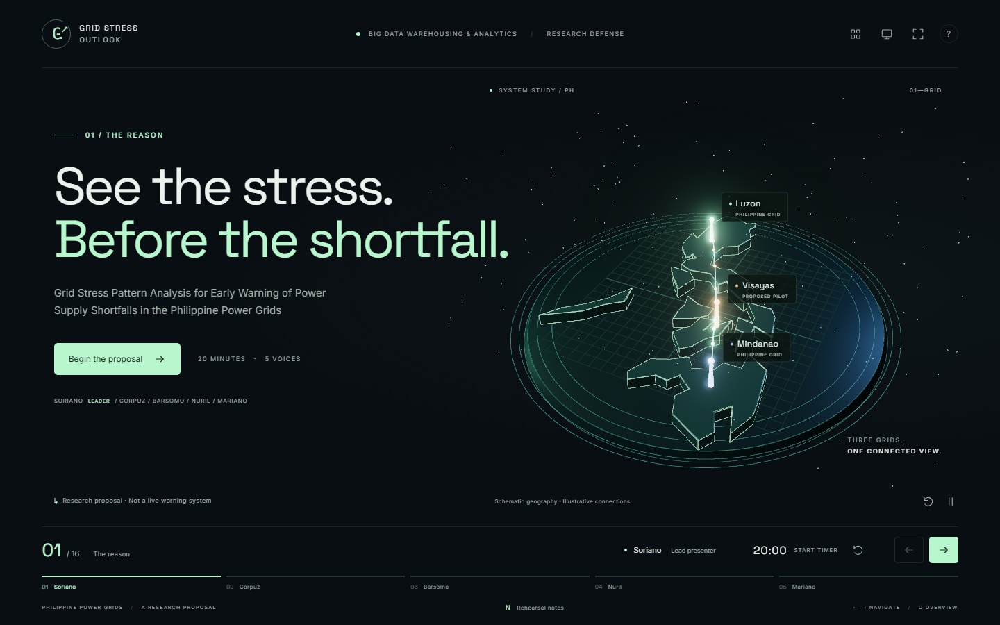

# Grid Stress Outlook

**A 20-minute research defense for five presenters.** A focused 16-slide story, five optional appendix slides, dimensional Three.js visuals, plain-language scripts, and a private presenter window.

> Proposal, not a live warning service. Historical figures are cited; 3D scenes are illustrative; targets are not measured performance.



## Open in the classroom

The public presentation is designed for **GitHub Pages**, using GitHub alone—no Vercel, Netlify, account on another platform, or installation on the classroom PC. The normal `github.com/...` repository page displays source code; the separate `https://<owner>.github.io/grid-stress-outlook/` Pages URL displays the actual presentation.

**Presentation:** https://edmcorpuz.github.io/grid-stress-outlook/

**Source repository:** https://github.com/edmcorpuz/grid-stress-outlook

See [PUBLISHING.md](docs/PUBLISHING.md) for GitHub-only hosting and updates.

After publishing, open the Pages URL in Chrome or Edge, use fullscreen, and press **T** when Soriano begins. Open the page and check its 3D view before the defense. A first load needs internet. Once assets are loaded, navigation and the optional teaching demo do not call external services. For a no-network fallback, bring the printable script/PDF. `?static=1` skips WebGL on older classroom hardware.

## The team and timing

| Presenter | Slides | Time window | Topic |
|---|---|---|---|
| **Soriano — leader** | 1–3 | 00:00–04:00 | Problem and evidence |
| **Corpuz** | 4–6 | 04:00–08:00 | Objectives and sources |
| **Barsomo** | 7–9 | 08:00–12:00 | Architecture and warehouse |
| **Nuril** | 10–13 | 12:00–16:00 | Preparation and methods |
| **Mariano** | 14–16 | 16:00–19:30 | Warning design and validation |
| Shared buffer | — | 19:30–20:00 | Transitions / recovery |

Q&A is separate. If your 20 minutes must also include Q&A, rehearse a shorter talk.

- [Printable PDF script](docs/presentation-script.pdf)
- [Complete presentation script](docs/PRESENTATION-SCRIPT.md)
- Individual scripts: [Soriano](docs/presenters/soriano.md) · [Corpuz](docs/presenters/corpuz.md) · [Barsomo](docs/presenters/barsomo.md) · [Nuril](docs/presenters/nuril.md) · [Mariano](docs/presenters/mariano.md)
- [Likely defense questions and short answers](docs/DEFENSE-QA.md)
- [References and attribution](docs/SOURCES.md)
- [Corrections and simplifications](docs/CONTENT-CHANGES.md)

## Presentation controls

| Key | Action |
|---|---|
| ← / →, Page Up / Page Down | Previous / next slide |
| Space / Enter | Next slide (clicker-friendly) |
| Home / End | Opening / closing slide |
| O | Overview and technical appendix |
| P | Private presenter window |
| N | Rehearsal notes **visible on the current screen** |
| T | Start / pause the shared 20-minute timer |
| F | Fullscreen |
| M | Pause / resume decorative motion |
| Esc | Close a dialog |

The main talk stops on slide 16; it does not accidentally advance into the appendix. Open **O** for appendix questions. URLs such as `#slide-9` deep-link to a slide.

**Private notes:** use extended displays, not mirrored displays. Put the audience deck on the projector and the **P** window on your own display. Both windows must stay on the same origin/browser context; they synchronize through BroadcastChannel. On one shared screen, use printed notes instead. Browser popup blocking may need to be allowed.

**Timer:** starts manually with **T** or the Begin button; it does not auto-start from ordinary navigation. It continues based on elapsed wall-clock time while the tab is hidden, persists through reloads, and is shared with the presenter window. Reset with the circular-arrow button before rehearsal. The two windows are intended for one presentation, not independent concurrent sessions on the same origin.

**Print:** click **? → Print script / save as PDF**, or use browser Print. The print layout contains the complete script and references rather than a dark screenshot.

## Work on the project

Requires Bun 1.3.13, managed by mise. Node is not required to run the app in a browser.

```bash
mise install
bun install
bun run dev
```

```bash
bun test tests/content.test.ts
bun run build
bunx playwright install chromium
bun run test:e2e
bun run docs
bun run publish:pages  # publishes dist/ to the GitHub gh-pages branch
```

`bun run build` creates the static site in `dist/`. Use `bun run preview` to inspect it; opening the Vite source `index.html` directly as a `file://` URL is not supported. Tests run locally. Optional GitHub Actions templates are in `docs/workflow-examples/`; they are not active and are not needed for hosting.

## Edit content

`src/content.ts` is the single source of truth for titles, slide text, scripts, presenters, citations, and timing. After edits, run `bun run docs` to regenerate the Markdown handouts. Use `src/tokens.css` for colors and `src/scene.ts` for 3D scenes. Local fonts and map data are bundled; no runtime analytics, API keys, application backend, or live grid feed is included.

## Files

```text
src/             Presentation, content, styles, Three.js scenes
public/          Bundled simplified geographic asset
originals/       Unmodified user-supplied HTML and Markdown
scripts/         Handout generator
docs/            Scripts, Q&A, source notes, PDF, and preview
tests/           Content and browser checks
# gh-pages branch contains the generated site, served by GitHub Pages
```

See [SOURCES.md](docs/SOURCES.md) for software/font/geographic attribution. No blanket license is applied to the original user-supplied material.
